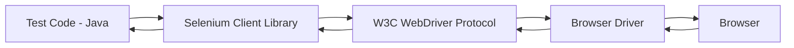

# 1. Selenium Introduction

## 1. Definition

**Selenium** is an open-source suite used to automate web browsers. It supports browser automation for testing and includes Selenium WebDriver, Selenium Grid, Selenium IDE, and integrations with Java test frameworks.

## 2. Uses

- Automate real user actions such as login, search, checkout, upload, and form submission.
- Run regression tests across Chrome, Firefox, Edge, and other supported browsers.
- Integrate browser checks with Maven and test frameworks such as TestNG or JUnit.
- Verify application behavior as a web application changes.

## 3. Selenium Architecture



The test sends WebDriver commands through the Selenium client and W3C protocol. The browser-specific driver translates those commands and controls the browser.

## 4. Selenium Components

| Component | Purpose |
|---|---|
| Selenium WebDriver | Creates browser sessions and controls web elements |
| Selenium IDE | Records and plays browser actions |
| Selenium Grid | Runs tests on remote machines, browsers, and operating systems |
| Client bindings | Java, Python, C#, JavaScript, Ruby, and other language APIs |

## 5. Basic WebDriver Syntax

```java
import org.openqa.selenium.WebDriver;
import org.openqa.selenium.chrome.ChromeDriver;

WebDriver driver = new ChromeDriver();
driver.manage().window().maximize();
driver.get("https://example.com");

System.out.println(driver.getTitle());

driver.quit();
```

Selenium Manager can locate or install a compatible browser driver in supported environments. Explicit driver setup is still useful in controlled CI environments.

## 6. Important Points

- Selenium automates browser actions; it is not a full test framework.
- WebDriver API tests should run in supported browsers.
- Use `quit()` to close all browser windows and end the WebDriver session.
- Prefer stable locators and synchronization over fixed `Thread.sleep()`.
- Selenium 4 uses the W3C WebDriver protocol.

## 7. Interview and Revision Notes

- Selenium is primarily used for web application automation, not desktop or native mobile apps.
- Selenium Grid distributes and executes tests across remote machines.
- `close()` closes the current window; `quit()` closes the session and all associated windows.
- Common automation limitations include CAPTCHA, 2FA, file downloads, and OS-native dialogs.

## 8. Quick Recap

- Use WebDriver for browser interaction.
- Use TestNG or JUnit for test structure and assertions.
- Use Maven for dependencies and execution.
- Always start with `get()` and end with `quit()`.