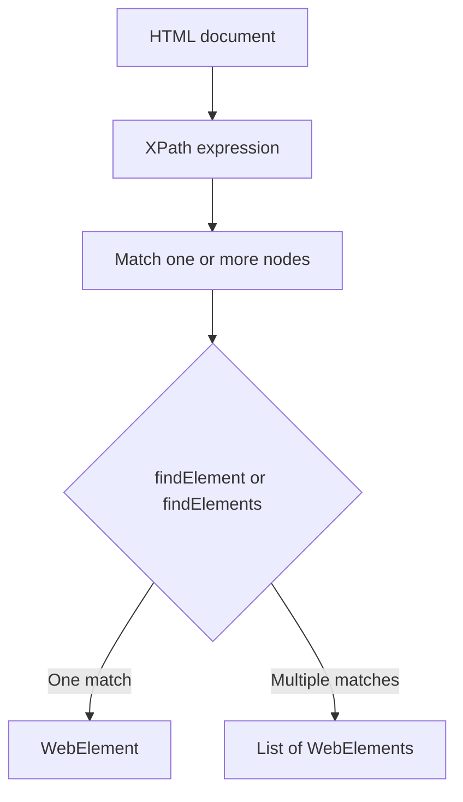

# 4. XPath

## 1. Definition

**XPath** is a query language for selecting nodes in an XML or HTML document. Selenium supports XPath to locate elements in complex DOM structures.

## 2. Uses

Use XPath when a stable `id`, `name`, or CSS selector is unavailable, especially for parent/child, sibling, and text-based relationships.

## 3. Syntax

```java
//tag[@attribute='value']
//tag[contains(@attribute,'partial-value')]
//tag[text()='Exact text']
//tag[contains(text(),'Partial text')]
//*[@attribute='value']
```

## 4. Common Examples

```java
driver.findElement(By.xpath("//input[@id='username']")).sendKeys("kiran");
driver.findElement(By.xpath("//button[@type='submit']")).click();
driver.findElement(By.xpath("//a[text()='Orders']")).click();
driver.findElement(By.xpath("//div[contains(@class,'product-card')]"));
```

## 5. Axis and Relationship Examples

```java
//label[text()='Email']/following-sibling::input
//table[@id='users']//tr[1]
//button[@id='save']/ancestor::form
//li[@class='selected']/preceding-sibling::li
//li[@class='selected']/following-sibling::li
```

## 6. Diagrammatic Representation



## 7. Important Points

- Prefer relative XPath starting with `//` over brittle absolute XPath starting with `/html/body`.
- Use unique attributes first.
- Avoid position-only expressions such as `(//button)[3]` when text or attributes can identify the element.
- XPath text matching does not always include normalized or descendant text.
- CSS may be shorter for simple selector cases.

## 8. Interview and Revision Notes

| Expression | Purpose |
|---|---|
| `//input[@id='x']` | Attribute match |
| `//input[contains(@name,'user')]` | Partial attribute match |
| `//*[text()='Login']` | Exact text |
| `//*[contains(text(),'Log')]` | Partial text |
| `//label[text()='Email']/following-sibling::input` | Relative relationship |
| `(//button)[1]` | First matching button |

- `//` searches descendants; `/` moves through a direct path.
- `[]` applies an XPath predicate.
- `@` selects an attribute.

## 9. Quick Recap

- Use relative XPath.
- Match stable attributes or meaningful text.
- Avoid indexes and absolute paths.
- Combine XPath only when simpler locators are inadequate.