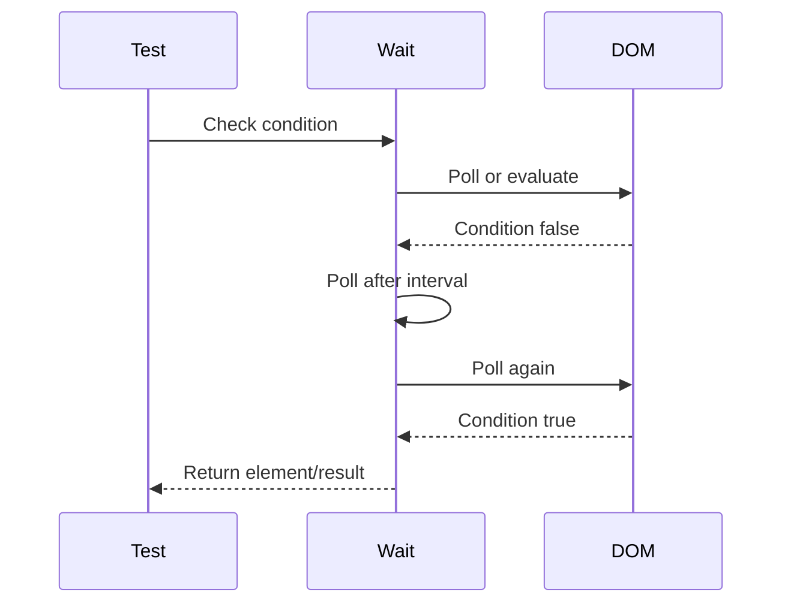

# 6. Waits and Synchronization

## 1. Definition

Synchronization makes test execution wait for a web page or element condition instead of assuming that it is already ready.

## 2. Uses

Use waits for:

- Dynamically loaded elements.
- AJAX and API-driven UI updates.
- Page and DOM transitions.
- Buttons that become enabled or visible.
- Elements that may briefly remain stale.

## 3. Implicit Wait

```java
driver.manage().timeouts().implicitlyWait(Duration.ofSeconds(10));
```

An implicit wait polls for elements located by `findElement()` or `findElements()`. It is not a recommended general wait for every condition.

## 4. Explicit Wait

```java
WebDriverWait wait =
    new WebDriverWait(driver, Duration.ofSeconds(10));

WebElement loginButton = wait.until(
    ExpectedConditions.elementToBeClickable(By.id("login"))
);
loginButton.click();
```

## 5. Fluent Wait

```java
Wait<WebDriver> wait = new FluentWait<>(driver)
    .withTimeout(Duration.ofSeconds(15))
    .pollingEvery(Duration.ofMillis(500))
    .ignoring(NoSuchElementException.class);

WebElement result = wait.until(
    driver -> driver.findElement(By.id("search-result"))
);
```

## 6. Common Explicit Conditions

```java
wait.until(ExpectedConditions.visibilityOfElementLocated(By.id("message")));
wait.until(ExpectedConditions.presenceOfElementLocated(By.id("row")));
wait.until(ExpectedConditions.elementToBeClickable(By.cssSelector("#submit")));
wait.until(ExpectedConditions.invisibilityOfElementLocated(By.id("loading")));
wait.until(ExpectedConditions.urlContains("/dashboard"));
wait.until(ExpectedConditions.titleIs("Dashboard"));
```

## 7. Diagrammatic Representation



## 8. Important Points

- Prefer explicit waits for a specific condition.
- Avoid fixed `Thread.sleep()`.
- Do not combine implicit and fluent waits unpredictably.
- `presenceOfElementLocated` does not require visibility.
- `visibilityOfElementLocated` requires the element to be displayed and have non-zero size.
- Increase timeout only for genuinely slow conditions.

## 9. Interview and Revision Notes

| Wait Type | Scope | Typical Use |
|---|---|---|
| Implicit | Every element lookup | Simple fallback; not usually recommended |
| Explicit | A specific condition | Most UI synchronization |
| Fluent | A specific condition with custom polling and exceptions | Complex dynamic behavior |
| `Thread.sleep` | Fixed JVM delay | Generally avoid in tests |

## 10. Quick Recap

- Wait for a condition, not a random number of seconds.
- Use `WebDriverWait` plus `ExpectedConditions`.
- Use `visibilityOf...` and `elementToBeClickable(...)` correctly.