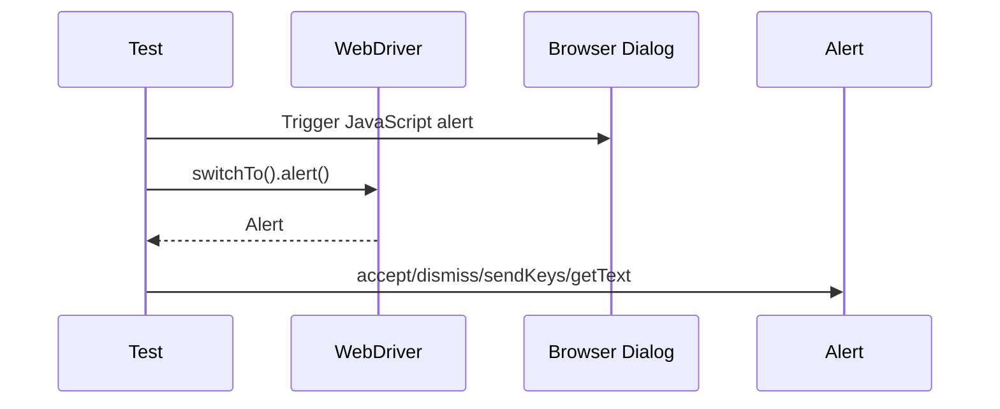

# 10. Alerts

## 1. Definition

A browser alert is a JavaScript dialog represented by Selenium's `Alert` interface.

## 2. Uses

Handle confirmation, prompt, and notification dialogs generated by `alert`, `confirm`, or `prompt`.

## 3. Syntax

```java
Alert alert = driver.switchTo().alert();
alert.accept();
alert.dismiss();
alert.sendKeys("text");
String message = alert.getText();
```

## 4. Examples

```java
WebDriverWait wait =
    new WebDriverWait(driver, Duration.ofSeconds(10));

Alert confirmation = wait.until(ExpectedConditions.alertIsPresent());
System.out.println(confirmation.getText());
confirmation.accept();
```

```java
Alert prompt = driver.switchTo().alert();
prompt.sendKeys("Kiran");
prompt.accept();
```

## 5. Diagrammatic Representation



## 6. Important Points

- Use an explicit wait for `ExpectedConditions.alertIsPresent()`.
- Switch to the alert before calling alert methods.
- Switch back to the original page context after the alert is handled.
- Modern browser authentication dialogs may require specialized handling and are not the same as JavaScript alerts.

## 7. Interview and Revision Notes

- `accept()` confirms the alert.
- `dismiss()` cancels or rejects it.
- `sendKeys()` is applicable to a prompt.
- `NoAlertPresentException` occurs when no alert exists.

## 8. Quick Recap

- Wait for the alert.
- Switch to it.
- Read or act on it.
- The page context remains available after accept/dismiss.
