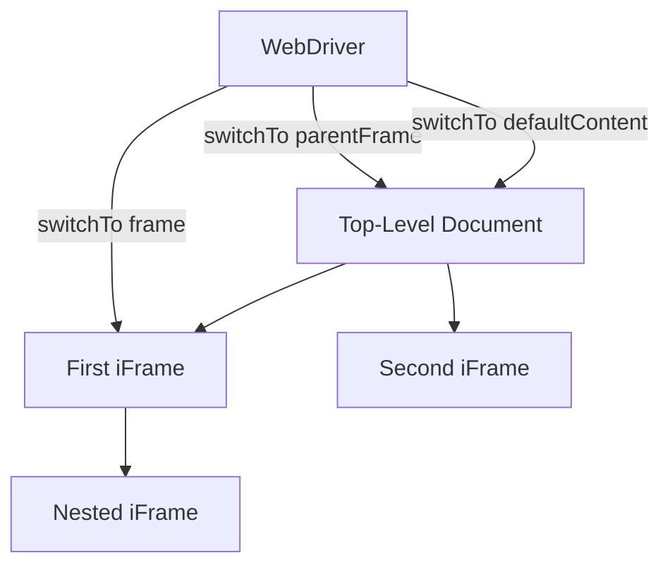

# 11. Frames and iFrames

## 1. Definition

A frame or iFrame creates a nested browsing context. Selenium cannot interact with elements inside it until the driver switches context.

## 2. Uses

Used for embedded payment forms, chat widgets, document editors, advertisements, third-party login, and video embeds.

## 3. Syntax

```java
driver.switchTo().frame("frameName");
driver.switchTo().frame(0);
driver.switchTo().frame(driver.findElement(By.id("paymentFrame")));

WebElement element = driver.findElement(By.id("cardNumber"));

driver.switchTo().defaultContent();
```

## 4. Example

```java
WebElement paymentFrame =
    driver.findElement(By.cssSelector("iframe[title='Payment']"));
driver.switchTo().frame(paymentFrame);

driver.findElement(By.id("cardNumber")).sendKeys("4111111111111111");

driver.switchTo().defaultContent();
```

## 5. Context Diagram



## 6. Important Points

- Switch by WebElement, name/ID, or index.
- `defaultContent()` returns to the top-level document.
- `parentFrame()` returns to the immediate parent.
- Nested frames require switching through each level.
- An element locator must be used only after the correct frame is active.

## 7. Interview and Revision Notes

- Frame switching is a context switch, not a navigation.
- An element outside the active frame cannot be found.
- Switching by element can be more stable than an index.
- `NoSuchFrameException` indicates an invalid or unavailable frame.

## 8. Quick Recap

- Locate the frame.
- Switch into it.
- Perform actions.
- Switch to parent or default content.
