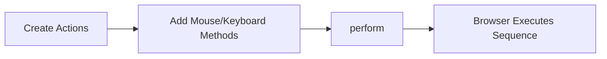

# 13. Mouse and Keyboard Actions

## 1. Definition

The Selenium `Actions` class sends low-level mouse and keyboard interactions to the browser.

## 2. Uses

Use it for drag-and-drop, hover menus, right-click, double-click, context menus, key combinations, and text selection.

## 3. Syntax

```java
Actions actions = new Actions(driver);

actions.moveToElement(menu).perform();
actions.contextClick(element).perform();
actions.doubleClick(element).perform();
actions.dragAndDrop(source, target).perform();
actions.sendKeys(element, Keys.ENTER).perform();
```

## 4. Examples

```java
Actions actions = new Actions(driver);

WebElement profileMenu =
    driver.findElement(By.id("profile"));
actions.moveToElement(profileMenu).perform();

WebElement search =
    driver.findElement(By.id("search"));
actions.click(search)
       .keyDown(Keys.CONTROL)
       .sendKeys("a")
       .keyUp(Keys.CONTROL)
       .sendKeys(Keys.DELETE)
       .perform();
```

## 5. Diagrammatic Representation



## 6. Important Points

- `build()` is optional; `perform()` builds and executes the action chain.
- Actions require a real interaction sequence; each method is added to the chain.
- `sendKeys(Keys.ENTER)` uses the keyboard.
- Browser or application behavior can affect low-level action reliability.
- Always synchronize before hovering or clicking.

## 7. Interview and Revision Notes

- `moveToElement` hovers.
- `contextClick` right-clicks.
- `doubleClick` double-clicks.
- `dragAndDrop` is one common drag-and-drop API.
- Use ordinary `click()` and `sendKeys()` when they meet the requirement.

## 8. Quick Recap

- Create `Actions`.
- Chain interaction methods.
- End with `perform()`.
