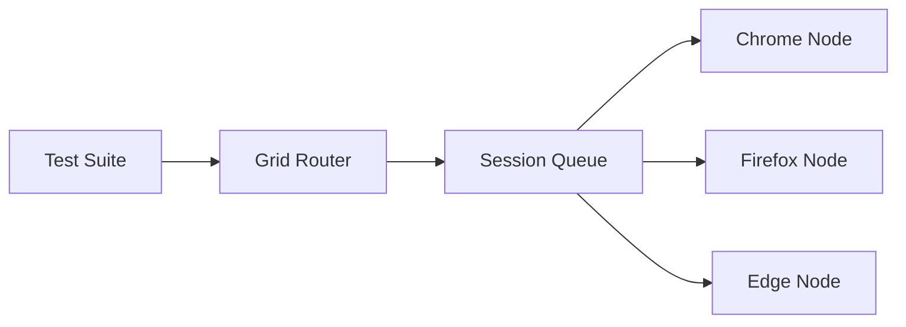

# 18. Selenium Grid

## 1. Definition

Selenium Grid distributes WebDriver test commands across remote machines or containers and returns results to the client.

## 2. Uses

Run browser combinations, operating systems, or test suites in parallel while managing infrastructure centrally.

## 3. Selenium 4 Standalone Syntax

```text
java -jar selenium-server-<version>.jar standalone
```

```java
ChromeOptions options = new ChromeOptions();
options.setPlatformName("Linux");
options.setBrowserVersion("stable");

WebDriver driver =
    new RemoteWebDriver(new URL("http://localhost:4444"), options);
```

## 4. Execution Diagram



## 5. Important Points

- Grid 4 supports standalone, hub/subordinate, and distributed modes.
- Use capabilities to request browser and platform combinations.
- A remote WebDriver uses the same Selenium Java APIs.
- Grid infrastructure should include logs, video, health checks, and cleanup.
- Selenium Grid is not a substitute for parallel test isolation.

## 6. Interview and Revision Notes

- Hub and node roles existed in earlier Grid designs; modern Grid uses router, distributor, session queue, and nodes.
- `RemoteWebDriver` sends commands to the remote endpoint.
- Test data and application dependencies must be visible to the remote environment.

## 7. Quick Recap

- Grid is for remote and parallel execution.
- Start a Grid service.
- Use `RemoteWebDriver`.
- Pass browser options and platform requirements.
