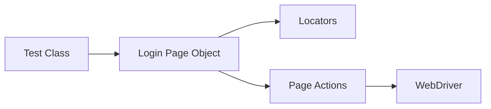

# 19. Page Object Model

## 1. Definition

Page Object Model (POM) separates page locators and page actions from test logic.

## 2. Uses

POM reduces duplicate locators, improves maintenance, and gives tests readable business actions.

## 3. Page Class Syntax

```java
public class LoginPage {
    private final WebDriver driver;

    private final By username = By.id("username");
    private final By password = By.id("password");
    private final By loginButton = By.id("login");

    public LoginPage(WebDriver driver) {
        this.driver = driver;
    }

    public void login(String user, String pass) {
        driver.findElement(username).sendKeys(user);
        driver.findElement(password).sendKeys(pass);
        driver.findElement(loginButton).click();
    }
}
```

## 4. Test Example

```java
LoginPage loginPage = new LoginPage(driver);
loginPage.login("kiran", "secret");
```

## 5. Structure Diagram



## 6. Important Points

- Keep assertions in test or verification layers, when practical.
- A page object should represent a page or meaningful reusable component.
- Avoid putting waits and assertions in locators.
- Return the next page object for a clear fluent workflow.
- Do not duplicate low-level Selenium calls across tests.

## 7. Interview and Revision Notes

- POM is a design pattern, not a Selenium feature.
- Locators and actions belong in page objects.
- Page objects improve maintainability but can become anemic or overly large.

## 8. Quick Recap

- One reusable page/component class.
- Private locators.
- Public business actions.
- Tests call actions and verify outcomes.
